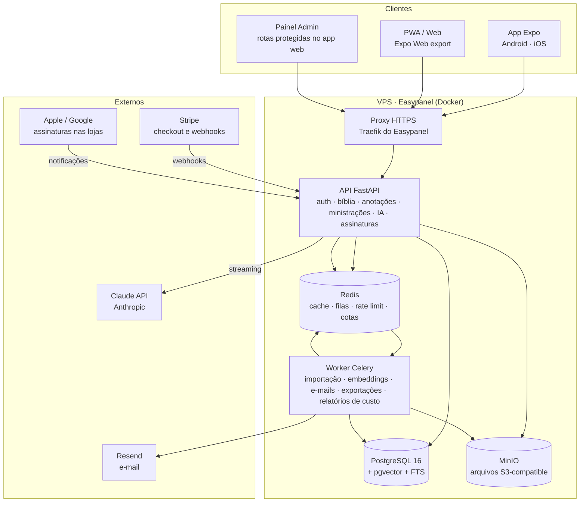

# BibleAlpha — Revisão Técnica (v0.2)

> Status: **em implementação** — Fases 1 a 5 prontas; andamento detalhado na seção 10.
> Itens marcados com **[verificar]** dependem de confirmação de licença, preço ou regra externa antes de serem usados.
>
> v0.2: marca BibleAlpha, assinatura Free/Pro, API da Claude, painel de custos de IA, Resend, repositório privado.

---

## 0. Decisões alinhadas

| Tema | Decisão |
|---|---|
| Marca | **BibleAlpha** · nome na loja: *BibleAlpha — AI Bible Study* · slogan: *Discover the Depth of God's Word.* |
| Domínio | `biblealpha.com`. Em 18/10/2026 o registro `.com` respondeu "não encontrado" (aparentemente livre). **Registrar o quanto antes**, mesmo que o DNS só seja configurado no final |
| Repositório | GitHub **privado** (nome sugerido: `biblealpha`) |
| Front-end | **Expo único** (Android, iOS, web e PWA). Next.js depois, só para páginas públicas/SEO |
| Backend | FastAPI + PostgreSQL + Redis + worker (Celery) |
| IA | **API da Claude (Anthropic)**, via SDK oficial `anthropic` em Python, atrás de uma camada independente de fornecedor |
| E-mail | **Resend** |
| Hospedagem | **Easypanel**, deploy automático a partir do GitHub. O VPS será ampliado se necessário |
| Domínios | Configurados no final. Até lá, homologação usa o domínio padrão do Easypanel |
| Validação | Todos os testes de produto acontecem **no PWA** antes de gerar Android/iOS |
| Modelo de negócio | **Free** (tudo liberado, IA com limite) e **Pro** (IA sem limite prático). Preço configurável no painel, com preço preservado para quem já assina |

---

## 0.1 Identidade visual

Logo oficial: [`assets/brand/logo-original.webp`](../assets/brand/logo-original.webp) (1254×1254): letra "A" dourada com fita sobre uma Bíblia aberta, luz radiante, fundo preto; wordmark "Bible" em branco/prata e "Alpha" em dourado, serifado.

**Tagline no logo:** *The Beginning of Understanding* — diferente do slogan definido antes (*Discover the Depth of God's Word.*). **Pendente: decidir qual usar** (ex.: uma no logo e outra na loja).

### Tokens de design derivados do logo (ponto de partida)

| Token | Valor aproximado | Uso |
|---|---|---|
| `gold-500` | `#E8B23A` | Cor da marca, botões principais, destaques |
| `gold-300` | `#F7D774` | Brilho, estados hover, gradiente |
| `gold-700` | `#A8761C` | Bordas, texto dourado sobre claro |
| `ink-950` | `#0B0906` | Fundo do tema escuro (padrão da marca) |
| `ink-900` | `#16120C` | Superfícies no tema escuro |
| `silver-100` | `#EDEBE6` | Texto principal no escuro |
| Tipografia | Serifada clássica para títulos e texto bíblico (ex.: Cormorant / Libre Caslon) + sans-serif limpa para a interface | |

O usuário escolhe entre tema preto e branco; o dourado é o acento nos dois. Para leitura longa, o dourado aparece só em detalhes, nunca no texto corrido.

### Uso do logo no app

O logo original é mantido sem alterações. Ícones de app, PWA e favicon, além das versões para fundo preto e branco, são recortes dele, gerados por `tools/brand/build.py`. Detalhes em [`assets/brand/README.md`](../assets/brand/README.md).

Pendências: busca de anterioridade da marca (INPI/USPTO) **[verificar]** e, se existir, o arquivo do logo em resolução maior.

---

## 1. Planos e cobrança

### Regras

| | Free | Pro |
|---|---|---|
| Bíblia, destaques, anotações, favoritos, sincronização | ✅ | ✅ |
| Devocionais, planos de leitura, ministrações, modo púlpito, biblioteca | ✅ | ✅ |
| Hebraico/grego, comparador, referências cruzadas | ✅ | ✅ |
| **IA** (explicações, estudo, gerador de ministração, devocional personalizado) | **Limitada** (cotas configuráveis no painel, ex.: X perguntas/dia e Y/mês) | **Uso livre** com proteção contra abuso |
| Geração de imagens (Fase 7) | a definir | a definir |

**Sobre o "ilimitado" do Pro:** recomendo um **teto técnico de segurança**, invisível no uso normal (ex.: limite de requisições por minuto e um teto diário bem alto, ajustáveis no painel). Ele existe para impedir que um script ou uma conta compartilhada gere um custo descontrolado. Ao atingir o teto, o usuário recebe uma mensagem, e o painel mostra quem chegou lá.

### Preço preservado para assinantes antigos

- `subscription_plans` (Free, Pro) + `plan_prices` com **versões** (valor, moeda, periodicidade, `valid_from`).
- Cada assinatura guarda a versão de preço contratada. Ao alterar o preço no painel, só **novos** assinantes pagam o novo valor. Uma migração de preço para assinantes antigos é uma ação explícita do admin, nunca automática.

### Meio de pagamento

| Canal | Como | Situação |
|---|---|---|
| **PWA / web** | Stripe (mundo todo): Checkout hospedado, portal do cliente e webhooks que ativam/cancelam o Pro | **Decidido: Stripe** (19/10/2026), chaves cadastradas no painel |
| **Android / iOS** | Lojas exigem compra dentro do app (Google Play Billing / Apple IAP) para assinaturas digitais, com comissão de 15–30%. Existem exceções por país para links externos | **[verificar]** regras vigentes no Brasil e EUA antes da Fase 8. Opção: RevenueCat para unificar web + lojas |

O backend terá um **serviço de assinaturas próprio** que recebe eventos de qualquer canal (webhook do gateway, notificações da Apple/Google) e mantém um único estado: `user_subscriptions.status` e `current_period_end`. O app só pergunta à API "qual é o plano deste usuário".

A doação deixa de ser o modelo principal. Pode continuar como opção ("apoie o projeto") se você quiser.

---

## 2. Controle de custos de IA

Requisito: **você precisa ver no painel quanto a IA custa no total e por usuário**, para decidir o preço do Pro.

### Como medir com precisão

Cada chamada à Claude devolve a contagem exata de tokens (`usage`: entrada, saída, leitura de cache e escrita de cache). Para cada chamada a API grava em `ai_usage`:

`user_id` · plano no momento · funcionalidade (explicar versículo, ministração...) · modelo · tokens de entrada / saída / cache · **custo em US$** calculado com a tabela de preços · cotação do dólar do dia → **custo em R$** · duração · sucesso/erro.

A tabela `ai_model_prices` guarda o preço por modelo com `valid_from`, editável no painel, para que mudanças de preço da Anthropic não reescrevam o histórico.

**Conferência mensal:** comparar o total do banco com o relatório oficial de uso e custo da Anthropic (exige uma Admin API key separada **[verificar]** se você terá acesso).

### O que o painel mostra

- Custo **hoje / mês / acumulado**, por funcionalidade, por modelo e por plano.
- **Custo por usuário**: ranking, histórico e detalhe de cada chamada (sem mostrar o conteúdo das perguntas, por privacidade).
- **Custo médio por assinante Pro × receita por assinante Pro → margem**. É o número que diz se o preço precisa subir para novos assinantes.
- Custo médio por usuário Free (quanto custa manter o plano gratuito).
- **Alertas e teto**: limite global de gasto diário/mensal, com aviso por e-mail ao se aproximar e corte seguro para o Free se for atingido.

### Modelos e custo estimado

Preços atuais da Anthropic por milhão de tokens (entrada / saída):

| Modelo | Preço | Uso sugerido |
|---|---|---|
| Claude Opus 5.5 | US$ 4 / US$ 20 | Exegese, hebraico/grego, gerador de ministração (alta qualidade) |
| Claude Sonnet 5.5 | US$ 2 / US$ 10 | Opção mais barata para explicações do dia a dia |
| Claude Haiku 5.5 | US$ 0,10 / US$ 0,50 | Classificar se a pergunta é bíblica, extrair referências, títulos |

O modelo de **cada funcionalidade** é escolhido no painel (`ai_model_configurations`). O padrão será o Opus 5.5. Você pode trocar qualquer tarefa para Sonnet ou Haiku depois de comparar qualidade e custo com dados reais.

Estimativa por pergunta típica de estudo (~6 mil tokens de contexto + ~2,5 mil de resposta e raciocínio), antes do desconto de cache:

| Modelo | Custo aproximado por pergunta |
|---|---|
| Opus 5.5 | ~US$ 0,07 |
| Sonnet 5.5 | ~US$ 0,04 |
| Haiku 5.5 | ~US$ 0,002 |

São números de planejamento. Os valores reais virão do painel após a Fase 3.

### Como reduzir o custo sem perder qualidade

1. **Prompt caching**: as instruções fixas do assistente ficam em cache, e a leitura de cache custa uma fração do preço de entrada.
2. **Classificador com Haiku** antes do modelo principal: pergunta fora do escopo não gasta Opus.
3. **Cache de respostas** para perguntas idênticas sobre a mesma passagem e modo (ex.: "explique João 3:16, modo simples").
4. **Nível de esforço (`effort`) por funcionalidade**: menor para devocional, maior para exegese.
5. **Batch API (50% mais barata)** para conteúdo gerado em lote, como o catálogo de devocionais diários.

---

## 3. Arquitetura



| Peça | Motivo |
|---|---|
| **Expo + Expo Router + TypeScript + NativeWind** | Um código para as 4 plataformas; PWA via export web; builds de loja via EAS |
| **FastAPI** | Python é o melhor ecossistema para IA e para importar corpora de hebraico/grego; SDK oficial da Anthropic em Python; OpenAPI automático |
| **PostgreSQL + pgvector** | Dados relacionais, busca textual com acentos e busca vetorial num só banco |
| **Redis + Celery** | Filas, cache, contadores de cota em tempo real |
| **MinIO** | S3 auto-hospedado no Easypanel |
| **Editor** | TipTap na web; o mesmo TipTap em WebView no app nativo no início (um só formato de documento) |
| **Painel admin** | Rotas protegidas por RBAC no app web, não um terceiro front-end |

---

## 4. Estrutura do monorepo

```
apps/
  app/                 Expo (Android, iOS, web/PWA, admin)
services/
  api/                 FastAPI (app/, alembic/, tests/)
  worker/              Celery (compartilha os modelos da api)
packages/
  ui/                  Design system (tokens, temas claro/escuro/sépia, componentes)
  types/               Tipos gerados do OpenAPI
  bible-reference-parser/  Parser de referências (TS) + fixtures JSON compartilhadas
  config/              ESLint, TS, Tailwind
data/
  importers/           Importadores por fonte, cada um com licença documentada
  sources/             Manifesto de fontes: URL, versão, hash, licença
infrastructure/
  docker/              Dockerfiles
  easypanel/           Serviços e variáveis de ambiente
docs/
tests/
  ai-eval/             Perguntas de avaliação com respostas verificadas
```

pnpm workspaces. O parser de referências terá implementação em TypeScript e em Python, ambas testadas contra **o mesmo arquivo de fixtures**.

---

## 5. Banco de dados

### Identificação canônica

Livros por código OSIS/USFM; `verse_key` inteiro `BBCCCVVV` (João 1:1 = `43001001`) dentro de um esquema de versificação; `verse_mappings` liga versificações diferentes.

### Grupos de tabelas

| Domínio | Tabelas |
|---|---|
| Usuários e segurança | users, user_profiles, sessions, refresh_tokens, auth_providers, user_preferences, roles, user_roles, audit_logs |
| Corpus bíblico | bible_sources, source_licenses, bible_translations, bible_translation_editions, bible_books, bible_chapters, bible_verses, verse_mappings |
| Idiomas originais | bible_original_texts, original_words, lexical_entries, morphology_entries, translation_alignments |
| Referências | bible_cross_references (`relation_type`, `source_id`) |
| Dados pessoais | bookmarks, highlights, highlight_categories, annotations, annotation_ranges, user_tags, reading_history, reading_progress |
| Devocionais | devotional_catalog, devotional_content, devotional_plans, devotional_plan_days, user_devotionals, devotional_progress |
| Ministrações | sermons, sermon_sections, sermon_references, sermon_versions, sermon_assets, sermon_templates, folders |
| IA | ai_conversations, ai_messages, ai_requests, **ai_usage**, **ai_model_prices**, ai_model_configurations, ai_retrieval_sources, ai_feedback, ai_generated_images, embeddings |
| **Assinaturas e cotas** | subscription_plans, **plan_prices** (versionado), **plan_limits**, user_subscriptions, payment_events (webhooks recebidos, idempotentes), usage_quotas, **ai_budget_alerts**, exchange_rates |
| Administração | system_settings, feature_flags, background_jobs, content_import_jobs, notification_preferences, notifications |

### Regras transversais

UUID em dados de usuário · `timestamptz` · exclusão lógica com lixeira · índices em toda FK · todo acesso a dado pessoal filtra por `user_id` na camada de repositório, com teste automatizado de isolamento · migrações Alembic · **o admin vê custos e metadados de uso, nunca o conteúdo de anotações, ministrações ou perguntas**.

### Sincronização offline

UUIDs gerados no cliente, fila local de operações, `PUSH` com `version` e `PULL` incremental. Destaques/favoritos: última escrita vence. Anotações e ministrações: **nunca sobrescrever**; conflito gera cópia e aviso.

---

## 6. Conteúdo e licenciamento bíblico

Nenhum texto entra no banco sem registro em `bible_sources` com origem, edição, hash e licença. Nada de scraping.

| Camada | Candidata | Licença esperada |
|---|---|---|
| Português principal | **Bíblia Livre (BLIVRE, 2018)**: atualização da Almeida 1819 (Textus Receptus), via eBible.org. Não foi encontrada uma Almeida de domínio público com origem digital documentada | **CC BY 4.0 BR** (uso livre com crédito obrigatório, exibido no app) ✅ importada |
| Português alternativo | Bíblia Livre **[verificar]** | Aberta com atribuição |
| **Inglês** | World English Bible (eBible.org engwebp) | Domínio público ✅ importada |
| Hebraico (AT) | Westminster Leningrad Codex + OSHB **[verificar]** | Domínio público / CC BY |
| Grego (NT) | SBLGNT; MorphGNT **[verificar]** | Aberta com atribuição |
| Strong, léxicos, interlinear | STEPBible (Tyndale House) **[verificar]** | CC BY |
| Referências cruzadas | OpenBible.info; Treasury of Scripture Knowledge **[verificar]** | CC BY / domínio público |
| ARA, ARC atual, ACF, NAA, NVI, NVT, NIV, ESV | — | **Protegidas**: só com contrato. Fora do MVP |

Como a marca e o nome na loja estão em inglês, ter uma versão inglesa de domínio público desde a Fase 2 ajuda a publicar nas lojas dos EUA. Cada versão mostra uma ficha com edição, fonte e licença. O app nunca dirá que uma tradução é "a única não modificada".

---

## 7. IA e RAG

### Camada de provedores

```
AIProvider (interface)
 ├─ AnthropicProvider  (SDK oficial `anthropic`, streaming, prompt caching)
 └─ (futuro) outros provedores
ai_model_configurations: funcionalidade → provedor + modelo + effort + limites
```

Prompts versionados no repositório. A chave da Anthropic fica só nas variáveis de ambiente do backend.

### Pipeline de uma pergunta

1. Recebe pergunta + passagem atual (enviada automaticamente pelo leitor).
2. **Verifica a cota** do usuário (Redis) antes de qualquer chamada.
3. Classificador (Haiku): fora do escopo → resposta padrão, quase sem custo.
4. Parser extrai referências citadas.
5. Recupera do banco: passagem, capítulos vizinhos, palavras originais, referências cruzadas.
6. Busca semântica (pgvector) em fontes autorizadas e, com permissão, nos estudos do próprio usuário.
7. Monta o contexto com cada trecho rotulado pela fonte; conteúdo recuperado é tratado como **dado**, nunca como instrução.
8. Gera a resposta em streaming, na estrutura: Texto analisado → Contexto → Explicação → Palavras importantes → Referências → Interpretações → Aplicação → Fontes.
9. **Valida** toda referência citada contra o banco; versículo citado entre aspas é comparado com o texto real.
10. Grava `ai_usage` com tokens e custo; atualiza a cota.

### Embeddings

A Anthropic não oferece um endpoint de embeddings. A busca semântica usará um **modelo multilíngue open-source rodando no worker** (sem custo por chamada). Os versículos são indexados uma vez; só a pergunta é vetorizada em tempo real.

### Avaliação

`tests/ai-eval/` com perguntas e respostas verificadas (referências inexistentes, confusão de personagens, erros de hebraico/grego, perguntas fora do escopo, diferenças entre tradições). Roda antes de trocar modelo ou prompt.

---

## 8. Plataformas e deploy

| Plataforma | Como |
|---|---|
| **PWA / Web** | `expo export --platform web` → container Nginx no Easypanel; manifesto + service worker |
| **Android / iOS** | EAS Build após validação no PWA |
| **Offline** | Nativo: SQLite. Web: IndexedDB. Camada `LocalStore` única |

| Serviço Easypanel | Imagem / origem |
|---|---|
| `web` | Dockerfile do app (build Expo web + Nginx) |
| `api` | Dockerfile FastAPI |
| `worker` | Mesmo código da api, comando Celery |
| `postgres` | `pgvector/pgvector:pg16` (a imagem padrão não traz pgvector) |
| `redis` | Redis oficial |
| `minio` | MinIO oficial |

Push no GitHub → Easypanel faz build e deploy. **Homologação** (branch `develop`) e **produção** (`main`) em projetos separados. Backups automáticos do Postgres, com cópia fora do VPS **[verificar]** destino.

---

## 9. Dependências externas e custos

| Item | Custo | Observação |
|---|---|---|
| VPS (Easypanel) | já existente | Ampliado conforme necessidade |
| Claude API | por token (seção 2) | Principal custo variável; acompanhado no painel |
| Resend | camada gratuita no início **[verificar]** limites atuais | Exige verificação de domínio (DNS) para enviar de `@biblealpha.com` |
| Domínio `biblealpha.com` | registro anual | Registrar já |
| Stripe | % por transação | Decidido |
| Apple Developer | US$ 99/ano | Fase 8 |
| Google Play | US$ 25 uma vez | Fase 8 |
| Comissão das lojas em assinaturas | 15–30% | Afeta a margem do Pro vendido pelo app **[verificar]** |
| EAS Build | camada gratuita com fila | |
| Geração de imagens | por imagem | Fase 7, provedor a definir |

---

## 10. Fases

| Fase | Entrega |
|---|---|
| **1 — Fundação** | Monorepo, Docker, Postgres/Redis/MinIO, FastAPI com auth completa (cadastro, confirmação de e-mail via Resend, recuperação de senha, sessões revogáveis, exclusão/exportação de conta), RBAC, design system BibleAlpha, navegação de 6 abas, PWA instalável, deploy de homologação no Easypanel |
| **2 — Bíblia** | Importação validada (PT + EN), leitor completo, busca por referência e palavra, destaques, anotações, favoritos, histórico, offline e sincronização |
| **3 — IA bíblica + custos** | Camada Anthropic, RAG, modos de explicação, IA contextual no leitor, validação de referências, **`ai_usage`, cotas Free, painel de custos (total e por usuário), alertas e teto global**, avaliação |
| **3b — Assinaturas** | Planos Free/Pro, preços versionados, gateway web com webhooks, tela de assinatura no PWA, métricas de margem no painel |
| **4 — Devocionais** | Diário, manual, temas, planos de leitura, notificações |
| **5 — Ministrações** | Editor, inserção automática de versículos, IA no editor com prévia, modelos, modo púlpito, PDF/DOCX |
| **6 — Estudo avançado** | Hebraico/grego, interlinear, Strong, comparador, referências cruzadas e grafo |
| **7 — Avançados** | Imagens, áudio, mapas, linha do tempo, ministração por voz, professor com IA, slides |
| **8 — Publicação** | Assinaturas nas lojas, builds Android/iOS, lojas, monitoramento |

### Andamento (18/10/2026)

- **Fases 1, 2, 3, 3b e 4**: implementadas (3b com Stripe).
- **Fase 5 — concluída.** Backend em `services/api/app/sermon/` e `routes/sermons.py` (conteúdo em blocos validado, modelos, versões a cada 5 min, conflito 409 por `base_version`, lixeira, duplicar, notas do púlpito, DOCX, IA para gerar e ajudar). App:
  - `src/sermon/document.ts`: lógica sem tela (histórico de desfazer/refazer que junta digitação seguida, metadados, operações em blocos, detecção de referências digitadas, modos do púlpito, HTML do PDF), coberta por `__tests__/sermon-document.test.ts` (inclui "João 3:16–18", "Romanos 12:1-2", "2 Reis 13:20–21", "Ef 1:18", "Jo 3:16", "Rm 12:2", "Gn 1:1").
  - `src/sermon/local.ts`: cópia local por ministração (rascunho com `dirty` + `baseVersion`); ao abrir com rascunho pendente sobre uma versão antiga, o rascunho é salvo como cópia ("cópia local").
  - Editor `app/sermon/[id]/index.tsx`, histórico `versions.tsx`, púlpito `pulpit.tsx` (sem cabeçalho), assistente `src/sermon/assist-sheet.tsx`, exportação `src/sermon/export.ts`.
  - Versículos: o pedido usa o código canônico do livro ("2KI 13:20-21"), então funciona com qualquer tradução; sem internet, usa o capítulo baixado para leitura offline.
  - PDF: no celular `expo-print` gera o arquivo e abre o compartilhar; no navegador o `expo-print` ignora o HTML, então o app imprime um iframe com o documento ("Salvar como PDF").
- **Fases 6 e 7**: não iniciadas.

---

## 11. Critérios de aceitação

**Fase 1**
- [ ] `docker compose up` sobe tudo localmente; healthcheck da API responde 200.
- [ ] Deploy de homologação no Easypanel a cada push em `develop`, com HTTPS.
- [ ] Cadastro exige aceite de termos; e-mail de confirmação chega via Resend e ativa a conta.
- [ ] Senhas com Argon2id; recuperação de senha com token de uso único e expiração.
- [ ] Usuário vê e revoga sessões; token revogado deixa de funcionar.
- [ ] Exportação de dados (JSON) e exclusão de conta funcionam.
- [ ] Teste automatizado: usuário A não acessa recurso do usuário B.
- [ ] PWA instalável e abre offline mostrando o app shell.

**Fase 2**
- [ ] Corpus com 66 livros, 1.189 capítulos e contagem de versículos conferida contra a edição.
- [ ] Parser reconhece todas as fixtures (`Jo 3:16`, `João 3:16–18`, `Rm 12:1-2`, `2 Reis 13:20–21`, `Gn 1:1`, `John 3:16`...).
- [ ] Busca por palavra ignora acentos e responde em menos de 300 ms no servidor.
- [ ] Destaque feito offline aparece em outro dispositivo após reconectar, sem perda.
- [ ] Texto bíblico não é editável por nenhuma rota de usuário.

**Fase 3 (custos)**
- [ ] Toda chamada à Claude gera um registro em `ai_usage`; a soma do mês bate com o relatório da Anthropic com diferença menor que 2%.
- [ ] Usuário Free bloqueado ao atingir a cota, com mensagem clara e convite ao Pro.
- [ ] Painel mostra custo total, por funcionalidade, por modelo e por usuário, sem expor o conteúdo das perguntas.
- [ ] Teto global atingido → Free suspenso na IA e alerta por e-mail ao admin.

---

## 12. Riscos e mitigação

| Risco | Mitigação |
|---|---|
| Custo de IA maior que a receita do Pro | Painel de margem por assinante, teto técnico no Pro, preço versionado para novos assinantes, troca de modelo por funcionalidade |
| Abuso do Pro "ilimitado" (scripts, conta compartilhada) | Rate limit, teto diário de segurança, limite de sessões simultâneas, alerta no painel |
| Comissão e regras das lojas para assinaturas | Vender primeiro pelo PWA; verificar regras de links externos no Brasil/EUA antes da Fase 8 |
| IA inventando versículos ou citações | Validação pós-geração contra o banco + suíte de avaliação |
| Edição da Almeida sem procedência clara | Só importar com edição documentada; ficha pública da tradução |
| Transferência internacional de dados (Anthropic, EUA) | Enviar só o necessário, nunca nome/e-mail; política de privacidade; opção de desativar a IA |
| Nome "BibleAlpha" já registrado como marca por terceiros | **[verificar]** busca no INPI e no USPTO antes de investir em identidade visual |
| Offline web × nativo | Camada `LocalStore` com testes nos dois |
| Editor rico no celular | TipTap em WebView primeiro |

---

## 13. Pendências

1. **Registrar `biblealpha.com`** agora (aparentava estar livre em 18/10/2026).
2. **Gateway de pagamento** para assinaturas no PWA (só necessário na Fase 3b).
3. **Preço inicial do Pro** e **cotas do Free** — podem ficar para a Fase 3, já com dados reais de custo.
4. **Idioma principal do app**: a marca é em inglês e o projeto começa em português. Proposta: interface PT-BR e EN desde a Fase 1 (i18n), Bíblia PT e EN na Fase 2.
5. **Conta GitHub** para criar o repositório privado (o GitHub CLI já está instalado nesta máquina).
6. **Node 20+** nesta máquina (hoje está na 18).
7. **Chave da Anthropic** e **chave do Resend** — só nas fases em que forem usadas; ficarão apenas nas variáveis do Easypanel.
